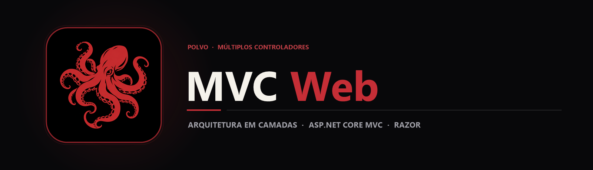

  

  Aplicação web em ASP.NET Core MVC que demonstra a separação entre Models, Views Razor e Controllers em três domínios independentes.

  
  
  

## Sobre o projeto

O padrão arquitetural **Model-View-Controller (MVC)** permite escalar sistemas web mantendo as regras de dados (Models), as telas de usuário (Views) e o roteamento de requisições (Controllers) estritamente separados. Este projeto foi desenvolvido na disciplina de Programação Web (Fatec/Etec Fernando Prestes) para consolidar esse fluxo na prática.

A aplicação implementa operações completas de **Listagem (Index), Cadastro (Cadastrar), Edição (Editar), Visualização (Visualizar) e Exclusão (Excluir)** para três contextos distintos: **Carros**, **Celulares** e **Eventos**.

## Principais recursos

| Recurso | Como funciona |
|---|---|
| Domínio de Veículos (Carro) | Modelo tipado, CarroController e 5 views Razor dedicadas ao ciclo completo de gerenciamento. |
| Domínio de Dispositivos (Celular) | Estrutura paralela de telas e modelo para catalogação e manutenção de aparelhos móveis. |
| Domínio de Agenda (Evento) | Modelagem e telas para registro, consulta e edição de eventos. |
| Roteamento Convencional MVC | Program.cs configura o pipeline HTTP e o mapeamento padrão {controller=Home}/{action=Index}/{id?}. |

## Tecnologias

  
  
  
  

- **C# & ASP.NET Core MVC** para controladores e entidades de negócio;
- **Razor Engine (.cshtml)** para renderização dinâmica de HTML no servidor;
- **Ativos estáticos (wwwroot/)** com CSS e scripts de interface.

## Arquitetura

`mermaid
flowchart LR
    A[Requisição HTTP] --> B[Roteador ASP.NET Core · Program.cs]
    B --> C[Controllers · Carro / Celular / Evento]
    C <--> D[Models · Entidades C#]
    C --> E[Views Razor · Index / Cadastrar / Editar / Excluir]
    E --> F[Resposta HTML Renderizada]
`

## Estrutura do repositório

`	ext
MVC-PW/
├── assets/
│   ├── banner.png                  Banner principal MVC Web
│   └── project-animal.png          Símbolo do polvo
├── Controllers/                    Controladores de rota (CarroController, etc.)
├── Models/                         Classes Carro.cs, Celular.cs, Evento.cs e ErrorViewModel.cs
├── Views/
│   ├── Carro/                      Telas Cadastrar, Editar, Excluir, Index e Visualizar
│   ├── Celular/                    Telas Cadastrar, Editar, Excluir, Index e Visualizar
│   └── Evento - Cópia/             Telas do módulo de eventos
├── wwwroot/                        Arquivos CSS, JS e bibliotecas estáticas
├── Program.cs                      Ponto de entrada e configuração do pipeline
└── MVC-PW.sln                      Solução Visual Studio
`

## Como explorar

1. Clone o repositório:
   `powershell
   git clone https://github.com/arthurlynow098/MVC-PW.git
   cd MVC-PW
   `
2. Abra a solução MVC-PW.sln no **Visual Studio** para navegar entre os Models, Controllers e Views de cada módulo.

---

Estudo · construção · evolução <a href="https://github.com/arthurlynow098">Perfil</a> · <a href="https://arthurentsev.vercel.app/">Portfólio</a> · <a href="https://www.linkedin.com/in/entsevarthur/">LinkedIn</a>

