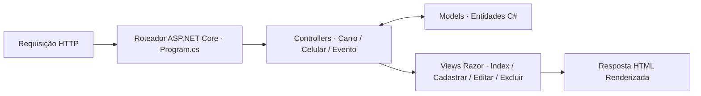

<p align="center">
  
</p>

<h1 align="center">MVC-PW</h1>

<p align="center">Estudo de aplicações MVC com cadastro de veículos, dispositivos móveis e eventos.</p>

<p align="center">
  
  
  
</p>

<p align="center"><a href="#visão-geral">Visão geral</a> &nbsp;·&nbsp; <a href="#recursos">Recursos</a> &nbsp;·&nbsp; <a href="#como-explorar">Como explorar</a></p>

---

## Visão geral

A aplicação implementa operações completas de **Listagem (Index), Cadastro (Cadastrar), Edição (Editar), Visualização (Visualizar) e Exclusão (Excluir)** para três contextos distintos: **Carros**, **Celulares** e **Eventos**.

## Recursos

| Recurso | Como funciona |
|---|---|
| Domínio de Veículos (Carro) | Modelo tipado, CarroController e 5 views Razor dedicadas ao ciclo completo de gerenciamento. |
| Domínio de Dispositivos (Celular) | Estrutura paralela de telas e modelo para catalogação e manutenção de aparelhos móveis. |
| Domínio de Agenda (Evento) | Modelagem e telas para registro, consulta e edição de eventos. |
| Roteamento Convencional MVC | Program.cs configura o pipeline HTTP e o mapeamento padrão {controller=Home}/{action=Index}/{id?}. |

## Tecnologias

- **C# & ASP.NET Core MVC** para controladores e entidades de negócio;
- **Razor Engine (.cshtml)** para renderização dinâmica de HTML no servidor;
- **Ativos estáticos (wwwroot/)** com CSS e scripts de interface.

<details>
<summary>Arquitetura</summary>



</details>

<details>
<summary>Estrutura do repositório</summary>

```text
MVC-PW/
├── assets/
│   └── project-animal.png          Emblema do projeto
├── Controllers/                    Controladores de rota (CarroController, etc.)
├── Models/                         Classes Carro.cs, Celular.cs, Evento.cs e ErrorViewModel.cs
├── Views/
│   ├── Carro/                      Telas Cadastrar, Editar, Excluir, Index e Visualizar
│   ├── Celular/                    Telas Cadastrar, Editar, Excluir, Index e Visualizar
│   └── Evento - Cópia/             Telas do módulo de eventos
├── wwwroot/                        Arquivos CSS, JS e bibliotecas estáticas
├── Program.cs                      Ponto de entrada e configuração do pipeline
└── MVC-PW.sln                      Solução Visual Studio
```

</details>

## Como explorar

1. Clone o repositório:
   ```powershell
   git clone https://github.com/arthurlynow098/MVC-PW.git
   cd MVC-PW
   ```
2. Abra a solução MVC-PW.sln no **Visual Studio** para navegar entre os Models, Controllers e Views de cada módulo.

---

<p align="center">
  <a href="https://github.com/arthurlynow098">GitHub</a> &nbsp;·&nbsp;
  <a href="https://arthurentsev.vercel.app/">Portfólio</a> &nbsp;·&nbsp;
  <a href="https://www.linkedin.com/in/entsevarthur/">LinkedIn</a>
</p>
